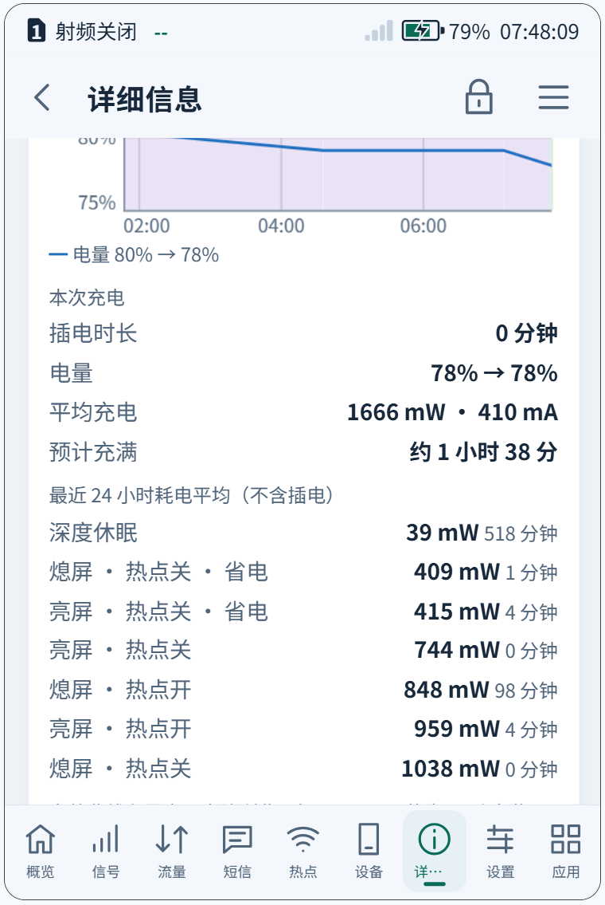

# e5-sleep 内核 · Deep Sleep Kernel for Rongyue E5

容悦 E5（展锐 UMS9621）OpenWrt 的深度休眠内核，当前版本 **`6.18.54-e5-sleep8-charles`**（补丁 0001–0009，[Release](https://github.com/CharlesGool/e5-sleep-kernel/releases/tag/kernel-e5-sleep8)）。

**刷机包已移到单独的仓库 [e5-openwrt-flasher](https://github.com/CharlesGool/e5-openwrt-flasher)**（含这个内核、按上游 e5-linux 从源码重建的系统、信息屏应用、LuCI 网页升级）；本仓库只发内核。

*A kernel for the Rongyue E5 running OpenWrt (e5-linux) that can sleep: the PMIC watchdog stopped across system suspend, CPU idle states, a display driver warning fixed, the GPU and camera power domains off in suspend so the AP reaches PMU deep sleep, the USB PLL released so the whole chip reaches chip-level sleep, the fuel gauge's sleep-calibration wake-up once in about 9 h instead of every 2320 s, and suspend with USB plugged in while USB data is off. Flash packages: [e5-openwrt-flasher](https://github.com/CharlesGool/e5-openwrt-flasher).*

官方 E5 内核构建流程（linux-lts-e5 `020b970e351e`，e5-sleep5 起是上游 e5-linux `bb8775e` 的内核适配：显示 / eMMC DMA / EIC / 温度 / SIPA / 电量计 / Wi-Fi SAE）加以下补丁：

| 改动 | 说明 |
|---|---|
| [0001](patches/0001-watchdog-ump9620-stop-across-system-suspend.patch) PMIC 看门狗挂起时停表 | `ump9620-pmic-wdt` 没有挂起处理，PMIC 休眠时照样计时，procd 被冻结无法喂狗，睡满 30 秒整机复位并回退进 Android |
| [0002](patches/0002-sprd-dpu-no-cancel-of-uninitialised-wb-work.patch) 显示驱动 | dpu_r6p1 未初始化 `wb_work` 却在每次挂起时 `cancel_work_sync()`，打印 WARNING |
| [0003](patches/0003-e5-mainline-config-cpuidle.patch) CPU 空闲状态 | 原内核 `CONFIG_CPU_IDLE` 未开，空闲核心只会 WFI；厂商设备树里的 PSCI 核心 / 簇断电状态（core-sleep、cluster-pd）现在能用了 |
| [0004](patches/0004-drm-panfrost-sprd-power-the-GPU-off-across-system-su.patch) 挂起时关 GPU | panfrost 的展锐胶水层只在 probe 时给 GPU 上电，挂起时不断电，GPU 电源域、GPLL、GPU DCDC 整夜开着 |
| [0005](patches/0005-soc-sprd-add-the-UMS9621-camera-subsystem-power-doma.patch) 相机电源域 | 新驱动 `sprd_camsys_pd`：引导程序留下上电的相机域开机即强制关断，有设备用时才开 |
| [0006](patches/0006-usb-musb-sprd-release-the-USB3.1-PLL-across-system-suspend.patch) 挂起时释放 USB PLL | musb 驱动开机就把 USB3.1 PLL 设成强制开启且从不释放，整颗芯片因此进不了芯片级休眠 |
| [0007](patches/0007-usb-musb-sprd-do-not-poll-while-USB-data-is-disabled.patch) USB 数据关闭时不轮询 | 原厂“禁用 USB 数据”开关为 0 时，musb 状态机每 200 毫秒醒一次空转 |
| [0008](patches/0008-power-supply-ump96xx-fgu-relax_cnt_threshold-module-parameter.patch) 电量计休眠校准唤醒 | 电量计的休眠校准每 2320 秒（设备树 580 × 4 秒）把系统唤醒一次读开路电压；模块参数 `relax_cnt_threshold` 默认 8191（约 9 小时），写 0 恢复设备树的值 |
| [0009](patches/0009-usb-musb-sprd-suspend-with-VBUS-while-USB-data-is-off.patch) USB 数据关闭时插着线也能挂起 | 设备模式下有 VBUS 时 musb 拒绝系统挂起；USB 数据关闭（`usb_data_enabled` 为 0）时端口没人用，按没插线处理：关控制器、PHY，释放 USB PLL |

0004 和 0005 合起来让 AP 子系统在挂起时真正进入 PMU 深睡（见下文“AP 深睡”）；0006 再让整颗芯片进入芯片级休眠
（关 26 MHz 晶振、降压，见下文“芯片级休眠”）。

配合[热点省电](https://github.com/CharlesGool/e5-hotspot-saver) v2.5 的深度休眠使用（关热点、熄屏后系统挂起到内存）。

## 实测

- 启动正常：92 个模块加载、0 失败，无 WARNING / Oops；调频 `sprd-cpufreq-v2` 正常（614 MHz–1.69 GHz）。
- cpuidle：`psci_idle` + `menu`，开机后约 200 秒内 CPU0 有约 47% 时间在核心断电或簇断电状态。
- 深度休眠：休眠 118 秒后电源键唤醒、屏幕点亮；挂起时不再有显示驱动 WARNING。
- 看门狗补丁未单独验证（没有 ftrace；直接让它睡过 30 秒而不停看门狗，失败会复位回 Android），
  热点省电的 sleep.sh 仍在挂起前后停 / 启看门狗，两者叠加无害。
- 休眠电流尚未长时间实测。

## 版本

| 内核 | 补丁 | 说明 |
|---|---|---|
| `6.18.54-e5-sleep8-charles` | 0001–0009 | 当前版本；上游 e5-linux `bb8775e` 的内核适配，编译者 `charles@e5`。[Release](https://github.com/CharlesGool/e5-sleep-kernel/releases/tag/kernel-e5-sleep8) |
| `6.18.54-e5-sleep5-charles` | 0001–0008 | 第一个按 bb8775e 构建的版本 |
| `6.18.54-e5-sleep4` | 0001–0007 | 官方 2026-10-13 刷机包的内核适配（e5-linux 359ae54） |
| `6.18.54-e5-sleep2` | 0001–0005 | |
| `6.18.54-e5-sleep1` | 0001–0003 | |

刷机包全部在 [e5-openwrt-flasher](https://github.com/CharlesGool/e5-openwrt-flasher/releases) 发布
（包括以前在本仓库发过的 e5-sleep2、e5-sleep4）。

## 功耗

**e5-sleep8 过夜实测：深度休眠约 9 mA，即 36–39 mW**（2026-10-18，射频关闭、热点关闭、熄屏）。
同样熄屏、关热点，官方原版刷机包约 1 W（不会休眠），相当于待机功耗降到原来的约 1/25。



- 功率监测（信息屏「详细信息」页）算出的 24 小时平均：深度休眠 **39 mW**，共 518 分钟；电量 80% → 78%。
- 电量计自己的休眠校准测得的电流与此吻合：内核日志 `sleep_time = 8193, sleep_cur_ma = 9`，电压 3999 mV，
  即一次睡 2 小时 16 分钟，平均 9 mA ≈ 36 mW。这是电量计硬件的库仑计数，不受电量百分比精度的影响。
- 一夜（开机 10 小时）只挂起 8 次：唤醒来源是 RTC 闹钟 3 次、电量计 1 次，其余为基带消息。
  0008 生效后，频繁唤醒的开销几乎为零。
- 8 次挂起全部进入 AP 深睡（`AP_DEEP_SLEEP_CNT` = 8）；芯片级休眠计数 `PAD_OUT_CHIP_SLEEP_EDG_CNT` 为 189
  （e5-sleep2 时一直是 1），0006 的芯片级休眠在正常发生。

| 版本 | 熄屏、关热点时的功耗 | 说明 |
|---|---|---|
| 官方原版刷机包 | 约 1 W | 系统从不挂起，只是熄屏、关热点，CPU 和外设一直运行（截图里“熄屏 · 热点关”一行的 1038 mW 也是这种状态） |
| e5-sleep2（0001–0005） | 约 19 mA / 73 mW | AP 深睡，但芯片级休眠从未发生；每 2320 秒被电量计唤醒一次 |
| **e5-sleep8（0001–0009）** | **约 9 mA / 36–39 mW** | 芯片级休眠；约 9 小时才被电量计唤醒一次 |

剩下的约 9 mA 是挂起时的固定底电流，来自主板上仍然通电的器件：Wi-Fi 芯片、射频关闭后仍待命的基带、屏幕面板、
音频功放、PMIC 没关的电源，以及电池自身的损耗。是否还有下降空间，要和同一台机器的安卓在飞行模式下过夜对比，
这一项还没测。

（之前说的“降到 40 mW 以下”来自 e5-sleep2 时一段很短的观察，那时电量计 0.1% 的精度不够，结论不准确；
现在 e5-sleep8 的长时间实测确实到了 40 mW 以下。）

## AP 深睡（0004、0005）

只有 0001–0003 时，挂起能成功（`suspend_stats/success` 递增），但 PMU 的 `AP_DEEP_SLEEP_CNT`
（PMU APB `0x64910dfc`）和 `PUB_DEEP_SLEEP_CNT`（`0x64910e60`）始终是 0：
CPU 都断电了，AP 子系统却从没进过 PMU 深睡，DDR 也没进深度自刷新。

原因是 **GPU 和相机两个电源域在挂起时仍然上电**。原厂安卓空闲时会把两者都强制关断：
`PD_GPU_CFG_0` 和 `PD_CAMERA_CFG_0` 的 FORCE_SHUTDOWN 置位，AON `APB_EB0` 的 GPU_EB / MM_EB 关闭。
OpenWrt 上：

- GPU：`panfrost_sprd.c` 只在 probe 时上电，只有卸载驱动时才断电；
- 相机：没有相机驱动，引导程序留下的上电状态一直保持。

查法：[`tools/e5_pdbg`](tools/e5_pdbg) 是一个 out-of-tree 模块，在 syscore 挂起阶段（只剩 CPU0）
经 SIP 调用 TF-A 的 `get_pdbg_info`。这就是原厂 sprd_pdbg 打印的 SLP_STATE / EB_INFO / PD_INFO / 深睡计数，
拿它和原厂安卓挂起瞬间的现场对比。实测（拔线，每次 RTC 挂起 45 秒）：

| 挂起 | 挂起瞬间 PD_INFO | AP_DEEP_SLEEP_CNT | PUB_DEEP_SLEEP_CNT |
|---|---|---|---|
| 0001–0003 | `…ffb7f0` | 0 → 0 | 0 → 0 |
| 只关相机域（0005） | `…fff7f0` | 0 → 0 | 0 → 0 |
| 相机域 + GPU（0005 + 0004） | `…fffff0` | 0 → 1 | 0 → 3 |
| 再一次 | `…fffff0` | 1 → 2 | 3 → 6 |
| 原厂安卓（对照） | `…fffff0` | 0 → 1 | 0 → 5 |

PD_INFO 中 `0x800` 对应 GPU、`0x4000` 对应相机，两个都关了 AP 才进深睡。恢复后 GPU 正常渲染（信息屏的 cage/cog）。
长时间待机功耗见上文「功耗」。

两个补丁都能干净地打到 linux-lts-e5 `020b970e351e` 上。0004 只改 `panfrost.ko`（模块），0005 是新模块，
所以不必重编内核：用同一份 e5-sleep1 构建树编出这两个 `.ko`，再用 `tools/repack-boot.py` 把 boot_b 里
initramfs 的 `panfrost.ko` 换掉，把 `sprd_camsys_pd.ko` 放进 rootfs 的 `/lib/modules/<release>/`，
并在 `/etc/modules.d/` 加一行，开机就会加载。二进制会随后续的刷机包一起发布。

相关工具：

- [`tools/e5_pdbg`](tools/e5_pdbg)：TF-A 休眠现场探测模块，`/proc/e5_pdbg` 可读当前值
- [`tools/apdeep-test.sh`](tools/apdeep-test.sh)：拔线后自动做“原样 / 关相机域 / 再换补丁 panfrost”三组挂起并记录计数器
- [`tools/decode-regs.py`](tools/decode-regs.py)：用厂商寄存器头文件给 regmap debugfs 导出命名，可对比两份导出

## 芯片级休眠（0006、0007）

有了 0004、0005，AP、DDR、基带、音频、传感器都进了深睡，但 PMU 的芯片级休眠计数
`PAD_OUT_CHIP_SLEEP_EDG_CNT`（`0x64910f3c`，芯片通知 PMIC 关晶振、降压的那根信号）在 136 次挂起后仍是 1，
原厂安卓一次 2 秒的挂起就从 1 变成 6。芯片级休眠的条件（`PAD_OUT_CHIP_SLEEP_CFG`）里有一条是**所有 PLL 都断电**；
对比两边的 `*_REL_CFG`，只有 USB3.1 PLL（`USB31PLLV_REL_CFG`，`0x64910a58`）在 OpenWrt 上是强制开启
（`0x45`，安卓插着 USB 也是 `0x44`）：musb 驱动在 probe 时为 USB2 PHY 的 26 MHz 参考时钟把它设成强制开启，之后再也不放。

0006 在 musb 的系统挂起里（设备模式只有没插线时才走得到这里）释放强制开启，恢复 PHY 前再打开。
先用 [`tools/e5_pllfix`](tools/e5_pllfix) 在 syscore 挂起阶段做同样的事验证，再写成补丁：

| 挂起（拔线，60 秒 RTC） | 芯片级休眠计数 | DDR 深睡计数 |
|---|---|---|
| 之前 136 次 | 一直是 1 | — |
| e5_pllfix 第 1 次 | 1 → 5 | 35 → 39 |
| e5_pllfix 第 2 次 | 5 → 8 | 39 → 42 |
| 0006 内核 | 1 → 4 | 0 → 3 |

唤醒后 USB 照常枚举。

0007 配合[热点省电](https://github.com/CharlesGool/e5-hotspot-saver) v2.8 的“USB 关闭（仅充电）”：它用原厂内核的
“禁用 USB 数据”开关（`/sys/class/usb_notify/usb_control/usb_data_enabled`），而开关为 0 时 musb 状态机每 200 毫秒
醒一次空转、打一行日志，拔了线也一样。开关写回 1 时驱动本来就会重新跑状态机，所以 0007 让它停下等待，
关闭 20 秒内不再有一次轮询（之前约 100 次）。

## 电量计休眠校准（0008）

深度休眠时系统大约每 2320 秒被唤醒一次，来源是电量计（UMP9620 FGU）的休眠校准：电池电流低于 30 mA 时，
它的 relax 计数器每 4 秒加一，数满设备树的 `sprd,relax-counter-threshold`（580）就唤醒系统读开路电压、校正电量。
0008 给 `ump96xx_fuel_gauge` 加模块参数 `relax_cnt_threshold`：默认 8191（寄存器 13 位的最大值，约 9 小时），
范围 320–8191，0 表示用设备树的值；每次挂起时读取，改了下一次挂起生效。这个模块在 boot_b 的 initramfs 里加载。

确认生效：`cat /sys/module/ump96xx_fuel_gauge/parameters/relax_cnt_threshold` 读出 `8191`，
每次挂起的内核日志里有 `Sleep calib mode config done!!! (relax_cnt_th 8191)`。

## 插着线也能挂起（0009）

musb 在设备模式下只要有 VBUS 就拒绝系统挂起（`Abort PM suspend in device mode`），所以插着线时从不休眠。
USB 数据关闭时（原厂“禁用 USB 数据”开关 `usb_data_enabled` 为 0，热点省电 3.0 的 USB“关闭（不充电）”就是这样，
同时充电芯片保持 HiZ、由电池供电），端口没有任何用途：0009 让它照没插线时那样挂起——控制器和 PHY 断电、
释放 USB PLL（0006），日志 `PM suspend with VBUS: USB data is off`。开关写回 1 时状态机照常重新运行。

## 安装 e5-sleep1（旧方法，已过时）

现在请直接用 [刷机包](https://github.com/CharlesGool/e5-openwrt-flasher)。下面是最早的 e5-sleep1 单独安装方法，留作参考。

**只适用于** 用 2026-10-13 刷机包（OpenWrt 25.12.5，内核 e5-mobile4）安装到手机存储（userdata）的 E5。
安装脚本会检查 boot_b 是否正是这个刷机包的镜像，不是就拒绝。

1. 下载 [`releases/`](releases) 里的 `e5-sleep1-boot-head.img.gz`、`e5-sleep1-modules.tar.gz`
   和 [`install/e5-sleep1-install.sh`](install/e5-sleep1-install.sh)，USB 连着电脑传到设备上同一个目录，例如：

   ```sh
   scp e5-sleep1-boot-head.img.gz e5-sleep1-modules.tar.gz e5-sleep1-install.sh root@192.168.9.1:/tmp/
   ```

2. SSH 登录设备，先检查（不写入任何东西），再安装：

   ```sh
   cd /tmp && sh e5-sleep1-install.sh --check && sh e5-sleep1-install.sh
   ```

   脚本会：校验文件；把模块装进 `/lib/modules/6.18.54-e5-sleep1-…`（原内核的模块不动）；
   把原 boot_b 备份到 `/mnt/e5-data/e5linux/boot_b-mobile4.img`，并放恢复脚本；写入新 boot_b 并读回校验。

3. `reboot`，约 2–3 分钟后 `uname -r` 应显示 `6.18.54-e5-sleep1-00072-g020b970e351e-dirty`。

新内核起不来时，bootloader 会自动回退进 Android（`e5-boot-ok` 只在系统完全起来后才重新标记 B 槽）。

## 从 Android 切回 OpenWrt

原版刷机包的 `flash.cmd --boot-openwrt` 会因 boot_b 哈希不同而拒绝（`boot_b holds another boot image`）。用：

- Magisk 的 E5 Linux 切回模块（只检查 boot_b 的 init，能通过）；或
- [`releases/Openwrt_E5_BootOpenwrt_sleep1.zip`](releases/Openwrt_E5_BootOpenwrt_sleep1.zip)：配新内核 boot.json 的精简刷机包，
  **只**支持 `flash.cmd --boot-openwrt`，其他命令一律拒绝（包里没有 rootfs 镜像）。

## 回到原内核

在 Android 里（adb + Magisk root）：

```sh
adb shell su -c sh /data/e5linux/restore-boot-b.sh
```

再用**原版**刷机包 `flash.cmd --boot-openwrt` 切回。原版包的 `--update` 也会把 boot_b 换回原内核。

## 自己编译

现在用的是 [`build/build-e5.sh`](build/build-e5.sh)：在官方构建容器 `e5-mainline-build` 里按 e5-linux 的
`device/linux_device_e5/prepare-kernel.py` 准备内核，再按 `SLEEP` 级别打补丁（1：0001–0003；2：+0004/0005；3：+0006；
4：+0007；5：+0008；6：+0009）。e5-sleep8 的做法（`TOP` 指向 e5-linux `bb8775e` 的检出，`k-sleep8` 是 linux-lts-e5
`020b970e3` 的 worktree）：

```sh
TOP=/path/to/e5-linux KBUILD_BUILD_USER=charles KBUILD_BUILD_HOST=e5 bash build/build-e5.sh sleep8 -e5-sleep8-charles 6
```

早期的独立脚本（e5-sleep1 / 2 / 4，x86_64 Linux + Docker，用 sprd-linux-devs 的公开源码）：

```sh
bash build/build-e5-sleep1.sh ./work          # 约 5 分钟（20 核）
REF=1 bash build/build-e5-sleep1.sh ./work    # 不加补丁的 e5-mobile4，用来和设备上的比较
SLEEP2=1 bash build/build-e5-sleep1.sh ./work # e5-sleep2：再加 0004、0005，相机电源域编进内核
SLEEP4=1 bash build/build-e5-sleep1.sh ./work # e5-sleep4：再加 0006、0007
python3 tools/repack-boot.py <刷机包>/files/boot.img work/dist-sleep1/Image.lk work/dist-sleep1/modules boot-e5-sleep1.img
```

构建用 e5-linux `569f13d` 的官方流程（`device/linux_device_e5/build-kernel.sh`：`prepare-kernel.py` 向干净的
linux-lts-e5 `020b970e351e` 注入 cpufreq v2 / SIP 服务、OTG、充电和 Wi-Fi 修复），在 e5-linux 的 `upstream/Dockerfile`
容器里（Ubuntu clang / lld 21.1.8，与设备内核相同）。`REF=1` 编出的 e5-mobile4 与设备上的一致：158 个模块大小全部相同，
Image.lk 同为 31262728 字节。

`tools/repack-boot.py` 以刷机包的 boot.img 为底，只换内核和 initramfs 里的 45 个 `.ko`，
init、busybox、f2fs 修复工具逐字节保留，vbmeta 和 AVB 尾部照搬（这台已解锁的设备不强制 AVB）。

刷机包（根文件系统、启动镜像、应用和升级脚本）的制作方法和脚本在 [e5-openwrt-flasher](https://github.com/CharlesGool/e5-openwrt-flasher)。

## 诊断工具

- [`tools/e5-sleep-diag.sh`](tools/e5-sleep-diag.sh)：只读诊断（mem_sleep、唤醒源、中断、cpuidle…）
- [`tools/e5-suspend-test.sh`](tools/e5-suspend-test.sh)：一次 RTC 唤醒的挂起测试
- [`tools/e5-autosleep-trial.sh`](tools/e5-autosleep-trial.sh)：拔线后清醒 / 自动休眠各一段的对比

## 许可

内核补丁与内核、模块二进制：GPL-2.0（源码：[sprd-linux-devs/linux](https://github.com/sprd-linux-devs/linux) e5-6.18 分支
`020b970e351e`、[sprd-linux-devs/e5-linux](https://github.com/sprd-linux-devs/e5-linux) `569f13d` 及其子模块，加本仓库 `patches/`）。
脚本与工具：MIT。initramfs 内容来自 e5-linux 2026-10-13 刷机包，许可同其上游。

本内核为非官方修改，与荣悦及设备、芯片厂商无关。刷机有风险，请先备份，风险自负。
